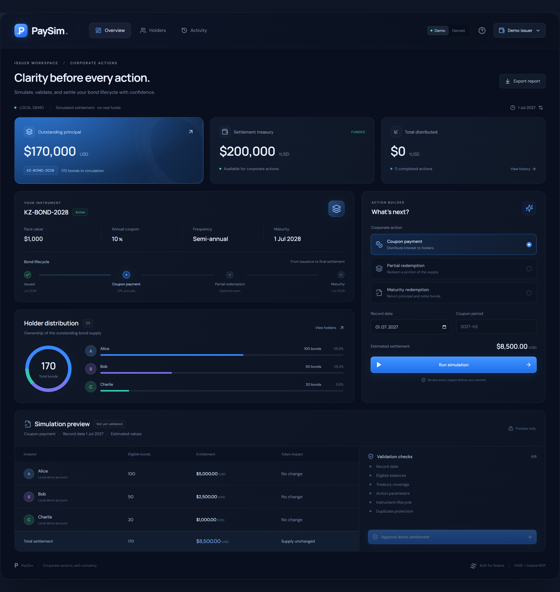
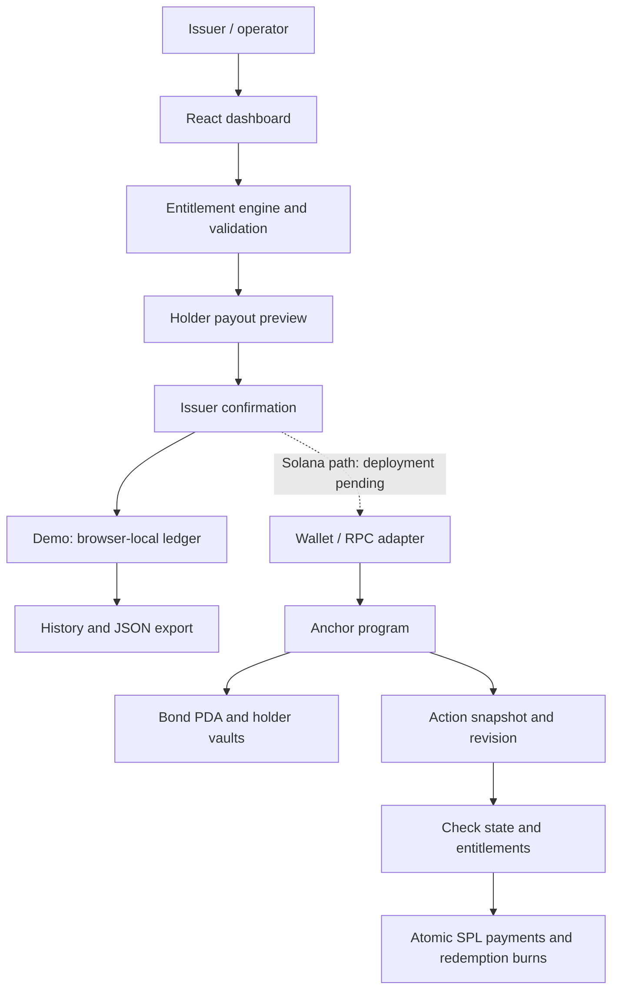

# PaySim — Clarity Before Every Bond Payment

> Simulate coupon payments and redemptions, review each investor's entitlement, and validate the impact before approval. Built for tokenized bonds, with a Solana settlement program in development.

[Live Demo](https://paysim-rho.vercel.app) · [Docs](docs/development.md) · [Solana Program Source](programs/paysim/src/lib.rs)



---

## Project Overview

PaySim is a corporate-action simulator with an initial focus on Kazakhstan's bond market. The MVP covers one instrument, three registered holders, and three actions: coupon payment, partial redemption, and maturity redemption.

| Name | Role | Contact |
| --- | --- | --- |
| nrnbekovv | Repository owner | [GitHub](https://github.com/nrnbekovv) |

**Status:** The web demo is hosted on Vercel and uses browser-local state. The Solana program, frontend adapter, and integration-test scripts are implemented, but the program has **not been deployed or verified end to end on-chain**. No real funds move in the hosted demo. PaySim has no claimed KASE affiliation or live KASE integration.

---

## Problem and Solution

### 1. Bond Payments Require Several Inputs to Agree

- **Problem:** Operators must reconcile bond terms, holder balances, dates, and available funds before a payment.
- **PaySim:** One workflow calculates investor entitlements and shows the proposed payment breakdown before approval.

### 2. Redemptions Change Future Obligations

- **Problem:** A partial redemption changes outstanding supply and the principal remaining at maturity.
- **PaySim:** Preview both cash payments and token retirement, then update the demo ledger after confirmation.

### 3. Invalid or Repeated Actions Need to Be Caught Early

- **Problem:** Incorrect dates, insufficient funds, stale balances, or duplicate coupon payments can invalidate an action.
- **PaySim:** Six visible validation checks explain whether the proposed action is ready for approval. Integer arithmetic handles settlement amounts.

### 4. Approval Needs a Reviewable Record

- **Problem:** An operator needs to understand what was approved and what changed afterward.
- **PaySim:** Inspect action history, holder balances, and downloadable JSON reports. Demo records are explicitly local records, not blockchain proofs.

---

## Why Solana

- **Program-controlled state:** A bond PDA stores instrument terms, registered holders, and the state revision.
- **Captured entitlements:** An Action account records a snapshot of proposed payouts and retired quantities.
- **Issuer authorization:** The program requires the issuer to authorize snapshots and execution.
- **Stale-state protection:** Settlement checks the captured revision and recomputes the expected result before execution.
- **Atomic settlement:** The implementation groups treasury transfers and redemption burns in one transaction so state changes succeed together or revert together.

These are implemented program rules, **not yet verified deployment results**. Snapshot creation and settlement are separate signed transactions. The intended environment is devnet with test tokens; real securities, banking rails, and production custody are outside this MVP.

---

## Summary of Features

- Coupon payments, partial redemption, and maturity redemption.
- Per-holder entitlement and token-impact previews.
- Record-date, balance, treasury, parameter, lifecycle, and duplicate checks.
- Issuer confirmation before local demo settlement.
- Holder distribution, outstanding principal, treasury, and payment statistics.
- Searchable holders, action history, and JSON export.
- Adjustable demo date and treasury, plus a confirmed ledger reset.
- Responsive dark navy dashboard with blue accents.
- Anchor program and Solana adapter prepared for deployment and integration testing.

---

## Tech Stack

| Layer | Technology |
| --- | --- |
| Frontend | React 19 · TypeScript · Vite 6 |
| UI | CSS · Lucide icons · DM Sans / Manrope |
| Calculation engine | TypeScript · integer minor-unit arithmetic using BigInt |
| Demo persistence | Browser localStorage |
| Solana client | `@solana/web3.js` · `@solana/spl-token` · wallet signing |
| On-chain program | Rust · Anchor 0.31.1 · SPL tokens |
| Hosting | Vercel |
| Validation | Node test runner · protocol sizing · browser smoke check; chain integration tests pending |

---

## Architecture



The live demo follows the local-ledger path. The Solana path remains unavailable until a program is deployed, initialized, and configured. See the [development guide](docs/development.md#solana-build-and-deployment) for setup and the [source](programs/paysim/src/lib.rs) for authorization and settlement rules.

---

## Quick Start

**Prerequisites:** Node.js 22.13+ and npm. Demo mode requires no wallet, signing keys, or environment variables.

```sh
git clone https://github.com/nrnbekovv/PaySim.git
cd PaySim
npm ci
npm run dev
```

Open the local URL printed by Vite, normally [http://127.0.0.1:5173](http://127.0.0.1:5173).

```sh
# Run calculation and state-transition tests
npm test

# Build the frontend
npm run build

# Check protocol layout and serialized transaction size
node scripts/check-protocol.cjs

# Preview the production build
npm run preview
```

### Try the Demo

1. Open the [live application](https://paysim-rho.vercel.app) in **Demo** mode.
2. Select **Coupon payment**, then **Run simulation**.
3. Review holder entitlements and the six validation checks.
4. Select **Approve demo settlement** and confirm.
5. Inspect **Activity**, **Holders**, or **Export report**.
6. Return to Overview to try a partial redemption. For maturity redemption, advance the demo date using the date/settings control.

The [complete walkthrough](docs/development.md#demo-walkthrough) includes expected calculations, failure cases, and reset instructions.

### Solana Development

Building and testing the program requires Solana and Anchor tooling. A fresh clone does not contain signing keys or a deployed program. Follow the [Solana setup guide](docs/development.md#solana-build-and-deployment) before running `npm run setup:devnet` or `npm run test:chain`.

---

## Validation Status

| Check | Result |
| --- | --- |
| TypeScript and production frontend build | Passed |
| Calculation / state-transition tests | 7 passed |
| Live browser smoke check | Dashboard loaded; coupon simulation passed 6/6 checks; no page errors observed |
| Three-holder transaction sizing | 581 / 1,232 bytes for the tested transaction format |
| Anchor SBF target type-check | Passed on the development host |
| Final program build, deployment, and chain integration tests | Pending |
| Independent security review | Not performed |

Transaction size and type-checking do not establish successful on-chain execution. The development guide records the current build and validator limitations.

---

## Roadmap

- [x] Implement coupon and redemption simulations with holder-level previews.
- [x] Add validation, approval, local history, and JSON export.
- [x] Publish the web demo on Vercel.
- [x] Implement Anchor program source and frontend transaction adapter.
- [x] Add domain tests, protocol checks, and chain integration-test scripts.
- [ ] Complete the program build and deploy to Solana devnet.
- [ ] Verify all three actions, authorization failures, stale-state rejection, and rollback on a validator.
- [ ] Validate the workflow with issuers, arrangers, and operations teams.
- [ ] Integrate a suitable holder registry, custody model, and settlement asset for a supervised pilot.
- [ ] Complete independent security and legal review before considering real assets or funds.

---

## Resources

- [Live Application](https://paysim-rho.vercel.app)
- [Source Code](https://github.com/nrnbekovv/PaySim)
- [Development Documentation](docs/development.md)
- [Anchor Program Source](programs/paysim/src/lib.rs)
- [Domain Tests](src/domain.test.ts)
- [Chain Integration Tests — Pending Execution](scripts/test-chain.ts)

**Demo scope:** One instrument and exactly three holders; no secondary trading, taxes, accrued-interest conventions, bank payments, or KASE data feed. The hosted app uses illustrative test balances. See [scope and rules](docs/development.md#scope-and-rules) for details.

---

## License

No project license has been specified yet. A license decision is pending.
